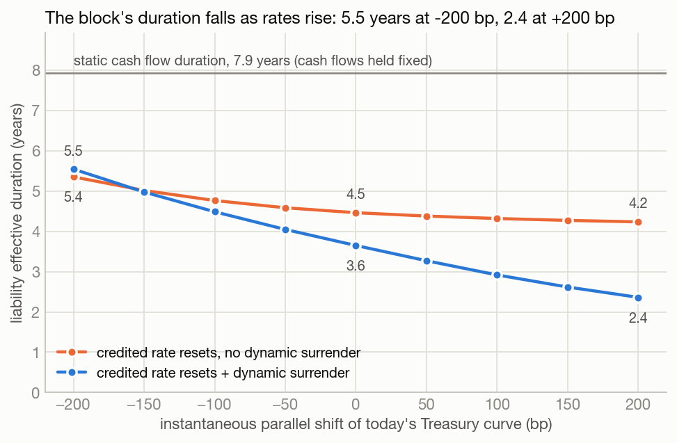
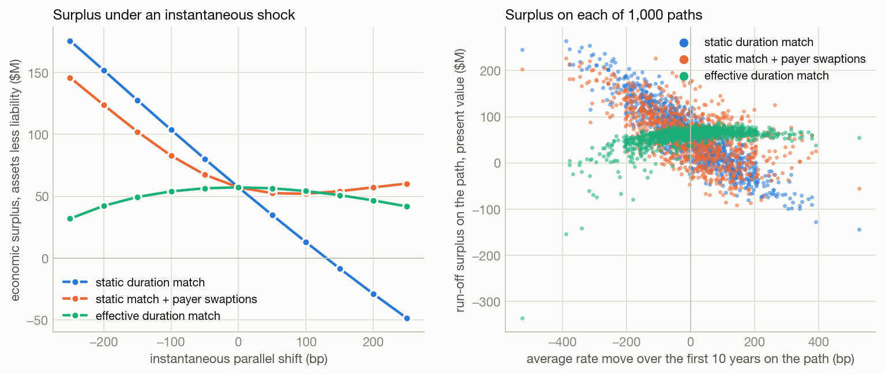
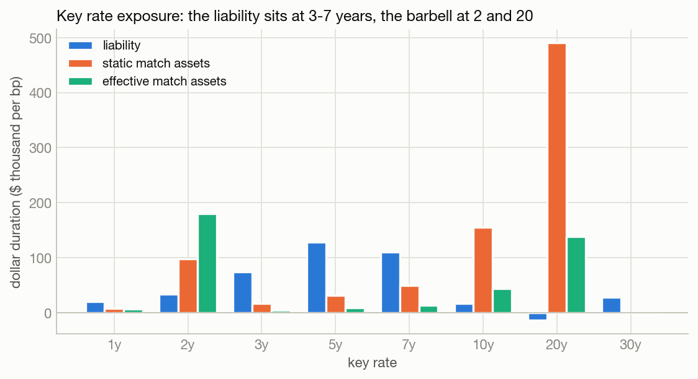
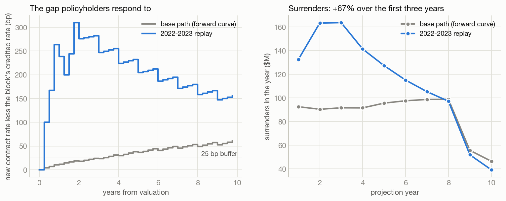

# Fixed Annuity ALM under Stochastic Interest Rates

An asset-liability model for a block of 10,000 single premium deferred annuities (SPDAs), valued on 1,000 Hull-White paths calibrated to the U.S. Treasury curve of 30 October 2026. The block has surrender charges, minimum guaranteed rates, a book yield crediting strategy, SOA 2012 IAM mortality and the NAIC/Academy dynamic surrender formula. The question is the one an annuity ALM desk asks after 2022: when rates jump and contract holders can walk away at book value, what does a duration-matched balance sheet actually lose, and what does it cost to stop it?

The headline is a gap between two durations. Project the liability cash flows once and hold them fixed, and the block has a duration of **7.9 years**. Revalue it on the Hull-White paths with credited rates and surrenders responding to rates, and its effective duration is **3.6 years**, falling to **2.4 years at +200 bp**. Assets matched to the 7.9 look hedged and are not: economic surplus loses **$86.0M** in an instantaneous +200 bp shock and **$129.3M** in a replay of the 2022-2023 rate rise. Payer swaptions costing **2.1% of account value** remove the +200 bp loss and cut the 99.5% expected shortfall of surplus from **$170.7M to $141.7M**.



## Results

Block: 10,000 contracts, $1,145.8M of account value, compressed exactly to 716 model points. Every number in this README comes from a CSV in `outputs/tables`; the main ones are collected in [`00_headline_numbers.csv`](outputs/tables/00_headline_numbers.csv).

| Liability | Value | % of AV | Effective duration | Effective convexity |
|---|---|---|---|---|
| **Dynamic surrender (base)** | **$1,088.6M** | **95.0%** | **3.65** | **88.7** |
| No dynamic surrender | $1,065.0M | 92.9% | 4.46 | 39.3 |
| Static cash flow duration (cash flows held fixed) | | | 7.93 | |

Dynamic surrender adds **$23.6M (2.06% of AV)** to the liability and more than doubles its convexity. The insurer is short that convexity.

| Assets ($1,145.8M, 2y/20y barbell, Treasury + 100 bp) | +200 bp shock | -200 bp shock | 99.5% VaR | 99.5% ES |
|---|---|---|---|---|
| Static match (DV01 matched to the 7.93 years) | -$86.0M | +$94.6M | $150.1M | $170.7M |
| Static match, if there were no dynamic surrender | -$60.0M | | $80.9M | $85.0M |
| Effective match (DV01 matched to the 3.65 years) | -$10.5M | -$14.9M | $125.8M | $214.1M |
| **Static match + 2y x 10y payer swaptions** | **$0.0M** | **+$66.5M** | **$128.1M** | **$141.7M** |

Shocks are instantaneous changes in economic surplus (assets less the stochastic liability value). VaR and ES are on the run-off surplus across the 1,000 paths, measured as the shortfall below the mean; bootstrap 90% intervals for ES are $151M-$188M (static), $128M-$301M (effective) and $130M-$147M (hedged).

## Why the liability is so much shorter than its cash flows

Two mechanisms, and they are not equally important.

**The credited rate resets (most of the gap).** Credited rate = book yield less 175 bp, and the book yield rolls toward the new money rate as the portfolio turns over at one seventh a year. When rates rise the account value grows faster, so part of the liability floats. Without any dynamic surrender this alone takes duration from 8.3 years (its own static figure) to 4.5.

**Surrenders respond to the rate gap (the part that moves).** A new contract can credit the new money rate less the same spread; this block is credited off a book yield that lags. The gap drives the Academy formula. It shortens the liability from 4.5 to 3.6 years at today's rates, and it makes duration *depend on rates*: 5.5 years at -200 bp, 2.4 at +200 bp. Without it, 5.4 and 4.2. That slope is what no static match can follow.

Of the static match's $86.0M loss at +200 bp, $60.0M would happen without dynamic surrender (the crediting reset); the surrender option adds the remaining $26M.

## Surplus across 1,000 paths



Surplus on a path is the present value of asset cash flows less benefit payments over the 30-year run-off, deflated at that path's own short rate. On average it equals the economic surplus at t = 0 ($57.2M); its spread is the mismatch.

The two portfolios fail on opposite sides. All five of the static match's worst paths are paths where rates rose; all five of the effective match's worst paths are paths where they fell, where the minimum guaranteed rate binds and short assets reinvest at low yields. Shortening the assets fixes the instantaneous shock (left panel, a shallow frown) but moves the tail rather than removing it. The liability is short an option on each side, and a duration match is a linear hedge.

So the hedge keeps the long assets, which protect the guarantee side, and buys protection only where the surrender option bites:

| Hedge | |
|---|---|
| Instrument | 2y x 10y payer swaption, struck at the forward swap rate (5.14%) |
| Sizing rule (set before looking at the tail) | offset the economic surplus loss in an instantaneous +200 bp shock |
| Notional | $839.7M (0.73 x AV), premium paid by selling bonds pro rata |
| Premium | **$24.5M, 2.13% of AV**; 72.5 bp normal vol, 14.1% Black-76 vol |
| 99.5% VaR | $150.1M to $128.1M (-15%) |
| 99.5% ES | $170.7M to $141.7M (-17%) |

The swaption is priced in closed form inside Hull-White (Jamshidian) and quoted back as Black-76 and normal volatility, the conventions from the coursework this project upgrades. Among 2, 3, 4, 5 and 7-year expiries into 10-year swaps, all sized by the same rule, the 2-year gave the most ES reduction per premium dollar (1.18 vs 0.91 for the 5-year; [`05_hedge_alternatives.csv`](outputs/tables/05_hedge_alternatives.csv)).

## Key rate durations



78% of the liability's key rate duration sits at 3, 5 and 7 years, because that is where the new money rate the contract holders compare against lives. 58% of the static match's sits at 20 years. Both portfolios match total DV01 and neither matches the shape. A one-factor model moves the curve almost in parallel, so this twist risk is invisible to the 1,000-path tail; it is reported here precisely because the simulation cannot see it.

## The 2022 replay



The 7-year Treasury rose 317 bp in the 21 months to 29 September 2023. Replayed on today's curve as a deterministic path, the gap between a new contract's rate and the block's credited rate opens to 310 bp, surrenders in the first three years rise from $274.5M to $459.4M (+67%), and the static match loses $129.3M of surplus. With the payer swaptions the same path gains $28.8M; the effective match loses $17.9M.

The post-2022 surrender wave is documented: the SOA/LIMRA fixed rate deferred study found surrender rates in the year the surrender charge expired of 54.0% by contract count in 2022 against 29.7% in 2015-2019 [1], its 2023-2024 update finds surrenders rising with the excess of market rate over credited rate both inside and after the surrender charge period [2], and AM Best reported annuity surrenders up 18% through the third quarter of 2023 against the prior year [3].

## Sensitivity

The assets stay at the base static match; each row changes one view of the liability or of rates ([`07_sensitivity.csv`](outputs/tables/07_sensitivity.csv)).

| | Effective duration | Convexity | 99.5% VaR | 99.5% ES |
|---|---|---|---|---|
| Dynamic surrender off | 4.46 | 39.3 | $80.9M | $85.0M |
| Academy formula x0.5 | 3.94 | 68.8 | $127.0M | $143.2M |
| **Academy formula (base)** | **3.65** | **88.7** | **$150.1M** | **$170.7M** |
| Academy formula x2 | 3.40 | 118.4 | $170.5M | $192.4M |
| NAIC drafting group power form | 4.11 | 98.8 | $154.4M | $221.4M |
| Crediting: book yield, 1/3 turnover | 2.80 | 65.9 | $158.3M | $176.0M |
| Crediting: new money rate | 1.71 | 67.5 | $186.1M | $204.2M |
| Crediting spread 125 bp / 225 bp | 4.00 / 3.37 | 79.8 / 106.0 | $133.8M / $165.1M | $153.3M / $186.0M |
| Hull-White sigma x0.5 / x1.5 | 3.41 / 3.96 | 86.2 / 94.0 | $87.2M / $190.3M | $102.6M / $206.8M |
| Mean reversion a = 0.05, sigma refit to 0.88% | 3.54 | 84.0 | $134.2M | $154.2M |

Stronger surrender response always shortens the liability and fattens the tail. Crediting closer to new money shortens the liability further (the static match is then even more mismatched), and the tail scales with volatility.

## What this project does

**Curve (`src/alm/curve.py`).** Treasury par yields for 30 Oct 2026 bootstrapped to zeros; all eleven input par bonds reprice to 100 within 2.8e-14. Upgraded from the author's fixed income coursework and behavioural-cashflow-engine.

**Rates (`src/alm/hull_white.py`, `calibration.py`).** Hull-White one factor, fitted exactly to the curve. The factor and its time integral are simulated jointly and exactly, so the deflator has no discretisation error; 1,000 antithetic paths, quarterly for 30 years, with a martingale adjustment so the path set reprices every zero coupon bond. There is no free, citable swaption volatility surface, so a and sigma are fitted to the realized volatility term structure of Treasury zero yields over the trailing 252 trading days, 2 to 30 years: **a = 0.0146, sigma = 0.77%**. In one-factor Hull-White every zero yield loads on the same factor with loading B(tau)/tau, so that term structure pins down both parameters, and sigma is the same under the real-world and risk-neutral measures. The model's swaption prices come out at 71-76 bp normal vol; sensitivity covers 0.5x to 1.5x sigma.

**Block (`block.py`).** Synthetic and seeded: issued evenly 2017-2026, issue age around 62, 55% female (inside the 52-57% the SOA/LIMRA study reports), lognormal account values. Minimum guaranteed rate by issue year is the NAIC Standard Nonforfeiture Law rate (5-year CMT less 125 bp, between 1% and 3%), so 2023-2026 issues carry 2.65%-2.95%. Surrender charges 7% to 1% over seven years.

**Behaviour (`lapse.py`, `mortality.py`).** Base surrender rates by attained age and position relative to the end of the charge period from the NAIC VM-22 Standard Projection Amount table built on LIMRA experience [4]. Dynamic surrender is the American Academy of Actuaries' linear formula from the same NAIC materials (multiples 3/5/6 on the gap beyond a 25 bp buffer, scaled down by the surrender charge, bounded); the tests reproduce the NAIC worked examples to the basis point [5]. Mortality is the SOA 2012 IAM Basic Table with Projection Scale G2.

**Projection (`projection.py`).** Quarterly, per path and model point: credit interest, pay deaths at account value and surrenders at account value less the charge, pay out at age 95 or the 30-year horizon. The credited rate is declared on each anniversary off the book yield, which is history at t = 0 and does not move when the curve is shocked.

**Analytics (`scripts/02`-`07`).** Effective duration and convexity from +-50 bp parallel shifts revalued on the same draws; key rate durations from triangular bumps at 1-30 years (they sum to 3.665 against an effective duration of 3.649); run-off surplus by path; deterministic stress paths; swaption hedge; sensitivities.

## Validation

`python -m pytest` runs 30 tests in about two seconds. The two that anchor everything:

- **Zero volatility reproduces the initial curve.** With sigma = 0 every path's deflator equals today's discount factor to machine precision, and every path bond price equals its forward price.
- **No surrender and no mortality gives deterministic discounting.** The liability equals the account value rolled up at the credited rate and discounted on the curve, exactly at sigma = 0 and within sampling error on 2,000 raw paths at sigma = 0.77%.

Others: path bond prices are martingales (this caught a missing term in the bond formula that biased yields on the paths low, more so the further out the path went); Jamshidian swaption prices match a 400,000-path simulation within 0.22 standard errors; account value is conserved to 1e-12 through deaths, surrenders and the final payout; the Academy and drafting group formulas reproduce the NAIC examples; the bootstrap reprices its inputs. On the production paths before adjustment, the martingale test is within 1.95 standard errors at every maturity.

## Limitations

- **Gaussian rates.** Hull-White allows negative rates: 1.2% of paths take the 3-month rate below zero within 10 years and 8.5% within 30. Three of the effective match's five worst paths are among them, so its falling-rate tail is partly a model artefact; the static match's tail (rates up) is not.
- **One factor.** The curve moves almost in parallel, so the 2022 replay matches the 7-year point but not the bear flattening, and the tail ignores twist risk. The key rate durations are the partial answer.
- **Volatility from realized, not implied.** Implied swaption vols usually sit above realized, so the hedge premium here is likely below the market's; the sigma sensitivity brackets it.
- **Risk-neutral tail.** The 99.5% figures come from the valuation paths. A real-world generator would move the centre of the rate distribution (the term premium), not its width, since sigma is measure invariant in this model. With 1,000 paths the tail is five paths, hence the bootstrap intervals.
- **Behaviour.** The base surrender table is FIA experience (the fixed rate study's tables are paid), the 2012 IAM is a payout annuitant table, and there are no partial withdrawals, expenses, taxes or credit losses. The competitor rate is the new money rate less the same 175 bp spread.
- **Swaps off Treasuries.** Swaption payoffs use the Treasury curve; swap spreads and SOFR basis are ignored.

## Repository structure

```
src/alm/
  curve.py          par yields -> zero curve, key rate bumps
  hull_white.py     exact simulation, path bond prices, Jamshidian swaptions
  calibration.py    realized volatility term structure -> (a, sigma)
  black.py          Black-76 and normal swaption formulas, implied vol
  block.py          in-force generation, minimum rates, exact compression
  mortality.py      2012 IAM Basic x Scale G2
  lapse.py          NAIC base table, Academy and drafting group dynamic formulas
  projection.py     cash flow projection along paths, liability value
  assets.py         bonds at a fixed spread, barbell matching, pathwise PV
  hedge.py          payer swaptions on paths
  scenarios.py      deterministic paths, the 2022 replay
  risk.py           duration, convexity, VaR, ES, bootstrap
  context.py        shared setup: data, calibration, block, the 1,000 paths
scripts/
  fetch_data.py     rebuild data/raw from Treasury and SOA (not run by run_all)
  01-09_*.py        pipeline steps, each writing CSVs to outputs/tables
  run_all.py        the whole pipeline
tests/              30 tests
data/raw/           Treasury par yields 2017-2026, SOA 2012 IAM + G2
outputs/tables/     every number above, as CSV
outputs/figures/    the four figures
```

## How to run

Python 3.10+ with numpy, scipy, pandas and matplotlib:

```bash
pip install -r requirements.txt
python scripts/run_all.py
python -m pytest
```

About 2.5 minutes end to end on a laptop. `run_all.py` reads the committed data snapshot, so the numbers above reproduce exactly; `python scripts/fetch_data.py` refreshes the data from source and will move them.

## Data and sources

- U.S. Treasury, Daily Treasury Par Yield Curve Rates, 2017 to 30 Oct 2026 (public domain).
- Society of Actuaries, 2012 IAM Basic Table and Projection Scale G2, ANB (mort.soa.org tables 2581-2584).

1. SOA Research Institute and LIMRA, *2015-2022 Fixed Rate Deferred Annuity Surrender Experience Study*, June 2024.
2. SOA Research Institute and LIMRA, *2023-2024 Fixed-Rate Deferred Annuity Surrender Study*, February 2026.
3. AM Best, special report *Annuity Surrenders Up Through 3Q23, Beating Premium Growth*, as reported by Reinsurance News, 1 February 2024.
4. NAIC VM-22 Subgroup, *Standard Projection Amount: Surrenders, Withdrawals and Dynamic Lapse Assumptions for FIA* (base rates from the 2019/2020 LIMRA FIA study).
5. NAIC VM-22 Subgroup, *Dynamic Lapse Comparison: SCL vs Academy vs NAIC Drafting Group*, 13 December 2023.

## Context

Built by Dillon (Tsun-Chun) Chang, UCLA Anderson Master of Financial Engineering 2026, previously an actuarial consultant on participating life pricing and mortality and lapse experience studies. [linkedin.com/in/tsun-chun-chang](https://www.linkedin.com/in/tsun-chun-chang/)
